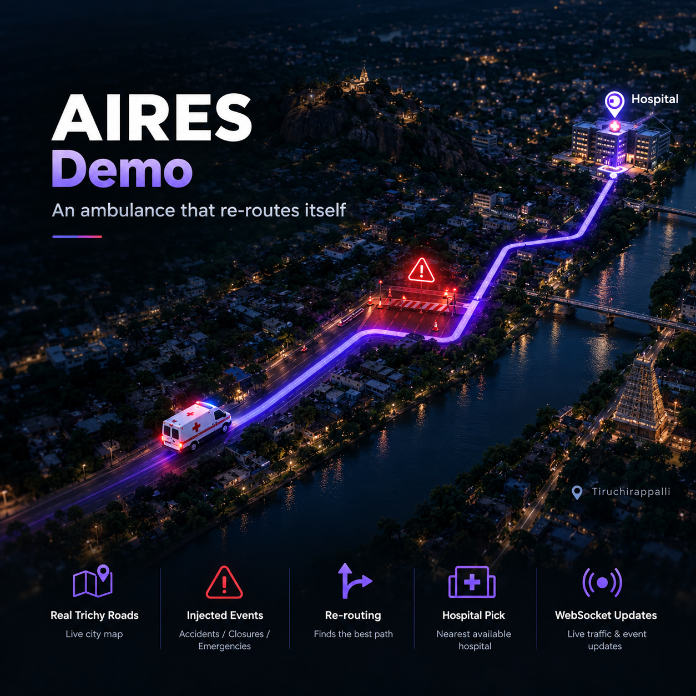

# 🚑 AIRES Demo

**Watch an ambulance re-route itself when a road is blocked.**
The demo page for AIRES, an AI emergency response system built as a student project.

[](https://aires-demo-eight.vercel.app)
[](https://github.com/ajeem-suban/AIRES-AI)
[](https://huggingface.co/AJEEM-SUBAN/AIRES-AI)
[](#)

> **AIRES (AI Intelligent Response & Emergency System)** is an AI-assisted ambulance dispatch and live re-routing platform.
>
> It picks a suitable hospital, plans a route over real road data, and re-plans the route when an event blocks it, pushing the new route to the driver screen and the hospital dashboard at the same time.

This repository holds only the **demo page**: one static `index.html` with the demo video, project details and author links. The AIRES application code lives in [AIRES-AI](https://github.com/ajeem-suban/AIRES-AI).

## 🌟 Vision

Ambulances lose minutes to blocked roads, accidents and wrong hospital choices, and drivers and hospitals usually learn about problems late and separately. AIRES explores keeping both sides updated from one routing decision.

## 🎯 Purpose

- Show AIRES working without asking anyone to install or run it
- Explain what is built, what is in development and what is planned
- Report the simulation results with their limits stated
- Link to the source code, the model hub page and the author

## 🏗 Architecture

How the AIRES system shown in the video is put together:

````mermaid
graph TD
    CP["Presenter Control Panel"] -->|"inject or clear event"| API["FastAPI Backend"]
    API --> ST["state.py - shared trip state"]
    API --> RT["real_router.py - route and re-route"]
    RT --> GR[("trichy_graph.pkl - real Trichy road graph")]
    API --> WS["WebSocket push"]
    WS --> DR["Driver Screen"]
    WS --> HD["Hospital Dashboard"]

**Design principle:** one backend owns the trip state and the routing decision, and both screens only display what the WebSocket pushes, so the driver and the hospital can never disagree about the route.

## 🔄 Workflow

```mermaid
flowchart TD
    A["Start trip - ambulance moves along planned route"] --> B{"Event injected?"}
    B -->|"No"| A
    B -->|"Accident, Flood, Traffic Jam or Construction"| C["Backend re-plans route on the real road graph"]
    C --> D["New route and ETA pushed over WebSocket"]
    D --> E["Driver screen updates"]
    D --> F["Hospital dashboard updates"]

## 📁 Current Repository

```
aires-demo/
├── index.html          # demo page: video, project details, simulation result, author links
├── aires-demo.mp4      # screen recording of the live re-routing demo
├── ajeem-suban.webp    # author photo shown on the page
├── assets/
│   └── banner.png      # README banner
└── README.md
```

_Flat structure by design: the page is a single static file with no build step._

## ✅ Current Features

- Dispatch logic and hospital recommendation
- Re-routing over a real road graph of central Trichy (15,152 junctions, 19,877 road stretches)
- Live updates through WebSocket when an event is injected or cleared
- Three demo screens: driver, hospital dashboard and presenter control panel
- Event types: Accident, Flood, Traffic Jam, Construction

**Simulation result** (300 runs, blocked road placed on the planned route):

| Event        | No re-route  | With AIRES              |
| ------------ | ------------ | ----------------------- |
| Accident     | 8.12 min     | 5.92 min                |
| Flood        | 8.38 min     | 6.13 min                |
| Construction | 7.64 min     | 5.76 min                |
| Traffic Jam  | 6.98 min     | 5.65 min                |
| **Average**  | **7.77 min** | **5.86 min (25% less)** |

AIRES was never slower than no re-routing in these runs. These numbers come from the project's test scripts, not from a real-world trial. Traffic, CCTV and weather events in the demo are injected manually from the control panel and are not live feeds.

## 🚧 In Progress / Planned

- Live GPS tracking and fuller dashboards (in development)
- CCTV and traffic-signal integration (planned)
- Voice call intake (planned)
- PostgreSQL storage (planned)
- Docker deployment (planned)
- Patient, ambulance and hospital details in the demo are placeholder data

## ▶ Run

### Preview this page locally

```bash
git clone https://github.com/ajeem-suban/aires-demo.git
cd aires-demo
python -m http.server 8000
```

Open `http://localhost:8000`.

### Deploy on Vercel

Import the repository at `vercel.com/new`, keep the framework preset as **Other**, leave the build command empty, and deploy.

### Run AIRES itself

Clone [AIRES-AI](https://github.com/ajeem-suban/AIRES-AI), then from its `backend` folder:

```bash
uvicorn app.main:app --reload --host 0.0.0.0
```

Open `http://127.0.0.1:8000/dashboards/`.

## 👤 Author


**Ajeem Suban (AJEEM.S)**
3rd-year B.Tech student in Artificial Intelligence and Data Science at Dhanalakshmi Srinivasan University, Tamil Nadu. Founder of TAMIL-AI, a Tamil-first NLP and RAG platform.

<br clear="left" />

[](https://github.com/ajeem-suban)
[](https://www.linkedin.com/in/ajeem-suban/)
[](https://huggingface.co/AJEEM-SUBAN)
[](https://ajeem-suban.vercel.app/)
[](mailto:ajeemsuban060@gmail.com)

## 🤝 Contributing

Fork → Branch → Commit → Pull Request

## 📜 License

MIT

_One routing decision, shown to everyone who needs it, at the same moment._
````
